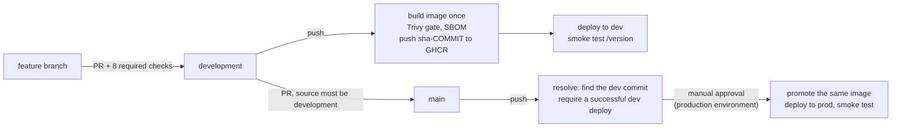
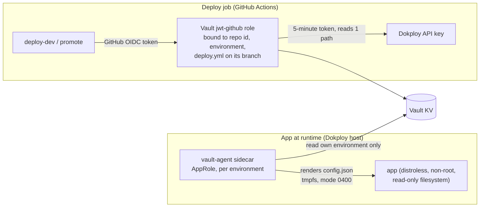

# secure-cicd-go

A small Go API that ships through a security-first CI/CD pipeline. The pipeline is the actual project:

- Every change passes automated security gates before it can merge.
- Production only ever runs an image that was already scanned and deployed to development, after a human approves it.
- No long-lived secret is stored in GitHub or baked into an image.

It is a portfolio project for a security platform engineering role. The data and setting are fictional.

| | |
| --- | --- |
| Development | https://secure-cicd-dev.nihacchi.fun (`/health`, `/version`) |
| Production | https://secure-cicd.nihacchi.fun (`/health`, `/version`) |
| Stack | Go 1.27, GitHub Actions, GHCR, Dokploy (Docker Compose), HashiCorp Vault |

## The problem it solves

In many teams, the path from a commit to production depends on people remembering to run scanners. Secrets also tend to live in CI settings, `.env` files and images. This project shows the opposite:

- **Controls are enforced by the platform, not by habit.** Branch rulesets make each security check a required status check. An admin cannot skip them, because there is no bypass list.
- **Secrets are fetched at runtime from Vault, scoped per environment.** The app gets its secrets through a Vault Agent sidecar. The CI deploy job gets the Dokploy key through GitHub OIDC. Neither stores a Vault credential in GitHub.
- **Exceptions are explicit and expire.** A finding can only be accepted with an owner, a reason and an expiry date of at most 90 days. A required check enforces this.

## How a change reaches production



- **Build once, promote the same image.** `main` never rebuilds. It retags the exact `sha-<commit>` image that passed the scans and ran in development.
- **Smoke test proves what is running.** A deploy only counts when `/version` reports the expected commit.
- **Merge commits only**, and `main` only accepts PRs from `development`, enforced by the `source-branch` check.

## Security gates

All of these are required status checks in the rulesets for `development` and `main` (see `docs/rulesets/`).

| Check | Tool | Fails the PR when |
| --- | --- | --- |
| `test` | gofmt, go vet, `go test -race` | Formatting, vet or a test fails |
| `gitleaks` | Gitleaks | A secret is found in the PR commits |
| `semgrep` | Semgrep (`p/golang`, `p/default`, `p/secrets`) | An ERROR-severity finding |
| `govulncheck` | govulncheck | Vulnerable code that is actually called |
| `dependency-review` | GitHub dependency review | A new dependency with a HIGH or CRITICAL advisory |
| `trivy-config` | Trivy (config) | A HIGH or CRITICAL Dockerfile misconfiguration |
| `trivy-image` | Trivy (image) | A fixable CRITICAL CVE in the built image |
| `exceptions` | `scripts/check-exceptions.sh` | An exception without owner, reason or valid expiry, or an expired one |
| `source-branch` | workflow check (PRs into `main` only) | The PR into `main` does not come from `development` |

SARIF results from Gitleaks, Semgrep and Trivy are uploaded to the repository's Security tab. Every third-party action is pinned to a full commit SHA.

## Secrets



**App secrets (JWT signing key, AES key):**
- Read by a Vault Agent sidecar using an AppRole for its own environment. The development role cannot read production secrets.
- Rendered into an in-memory volume that only the app mounts read-only.
- The app is distroless, non-root and has a read-only filesystem. It exits if its config is missing or invalid.

**CI secret (Dokploy API key):**
- Not stored in GitHub.
- The deploy job exchanges its short-lived GitHub OIDC token for a 5-minute Vault token. That token can read one path: the key for its own environment.
- A pull request, another branch or another workflow file is refused by Vault.

The Vault policies and roles are kept in `vault/`, so access changes go through review.

## Exceptions

When a finding cannot be fixed yet, it can be accepted through a PR. Each exception covers exactly one finding:

```
# exception: owner=@dimss113 exp=2026-12-31 reason="no fixed version upstream yet, tracked in #20"
CVE-2026-12345 exp:2026-12-31
```

- `exceptions` blocks a PR with a missing, invalid, too-long (more than 90 days) or expired exception.
- A weekly `exception-expiry` workflow fails when one runs out.
- Broad suppressions are banned: `.semgrepignore`, a bare `nosemgrep`, `gitleaks:allow` and others.
- Details: [docs/exception-process.md](docs/exception-process.md).

## Proof

The controls were exercised with demo pull requests that were closed without merging:

- A hardcoded secret, a vulnerable dependency, a root container, a command injection, and a PR into `main` from a feature branch. All were blocked by the required checks.
- An accepted-risk exception that turns red once it expires.
- A false positive accepted by Gitleaks fingerprint.
- A pull request job whose OIDC token Vault refuses for both deploy roles.
- Vault isolation: a development credential gets `403 permission denied` on production paths.
- Each build publishes a CycloneDX SBOM as a workflow artifact.

## Run it locally

```bash
make test     # go test -race ./...
make lint     # gofmt + go vet
make run      # starts on :8080 with dummy secrets from testdata/
curl -s localhost:8080/version
```

| Endpoint | Purpose |
| --- | --- |
| `GET /health` | Liveness |
| `GET /version` | Running commit and build time |
| `POST /v1/tokens`, `GET /v1/me` | Issue and verify a short-lived HS256 JWT |
| `POST /v1/encrypt`, `POST /v1/decrypt` | AES-256-GCM with the key from Vault |

## Accepted risks and known limitations

| Item | Why it is accepted | Mitigation |
| --- | --- | --- |
| The Dokploy API key is static (90 days) and account-wide | Dokploy has no per-service or short-lived tokens | Stored only in Vault, readable only by the deploy job of its environment, rotated by runbook |
| AppRole `secret_id` for the sidecar is static in Dokploy | Kept simple for this project | Read-only policy on its own environment, short Vault token TTL, can be revoked at any time |
| Deploys reference a tag, not a digest | Digest pinning and image signing are a follow-up project | The smoke test checks that the running commit is the scanned commit |
| Docker Compose hardening is reviewed, not checked automatically | Trivy does not scan Compose files | PR review; policy-as-code (OPA/Conftest) is a follow-up project |
| A rotated app secret is used only after a restart | The app reads its config once at start and fails closed | Vault Agent re-renders the file; a restart picks it up |
| Semgrep `nosemgrep` exceptions still raise an alert in code scanning | GitHub ignores the in-source suppression in SARIF | The alert stays visible in the Security tab and is dismissed with the same reason |

## Repository layout

```
cmd/api/               entrypoint
internal/              config, token (JWT), cryptobox (AES-GCM), httpapi, buildinfo
Dockerfile             multi-stage, distroless, non-root, base images pinned by digest
vault-agent/           sidecar image and template
vault/                 Vault policies and CI roles
docker-compose.*.yml   development, production and local stacks
scripts/               deploy + smoke test, exception check
docs/                  exception process, rulesets
.github/workflows/     pr-checks, source-branch, deploy, exception-expiry
```
